

<picture><source media="(prefers-color-scheme: dark)" srcset="assets/hero-dark.svg"></picture>

<picture><source media="(prefers-color-scheme: dark)" srcset="assets/social-l-dark.svg"></picture><a href="https://www.youtube.com/@blxssvdd"><picture><source media="(prefers-color-scheme: dark)" srcset="assets/social-1-dark.svg"></picture></a><a href="https://www.tiktok.com/@blvssxdv"><picture><source media="(prefers-color-scheme: dark)" srcset="assets/social-2-dark.svg"></picture></a><a href="https://open.spotify.com/user/kc8f8euuvl5kzr1e38qd4dw0o?si=eecb86c5a3344873"><picture><source media="(prefers-color-scheme: dark)" srcset="assets/social-3-dark.svg"></picture></a><a href="https://t.me/AlstonLiam"><picture><source media="(prefers-color-scheme: dark)" srcset="assets/social-4-dark.svg"></picture></a><picture><source media="(prefers-color-scheme: dark)" srcset="assets/social-r-dark.svg"></picture>

<picture><source media="(prefers-color-scheme: dark)" srcset="assets/about-dark.svg"></picture>

<picture><source media="(prefers-color-scheme: dark)" srcset="assets/stack-dark.svg"></picture>

<a href="https://github.com/blxssvdd/HandTrackingPaint"><picture><source media="(prefers-color-scheme: dark)" srcset="assets/project-handtrackingpaint-dark.svg"></picture></a>&nbsp;<a href="https://github.com/blxssvdd/SchoolHub"><picture><source media="(prefers-color-scheme: dark)" srcset="assets/project-schoolhub-dark.svg"></picture></a>

<a href="https://github.com/blxssvdd/Django-tournaments"><picture><source media="(prefers-color-scheme: dark)" srcset="assets/project-django-tournaments-dark.svg"></picture></a>&nbsp;<a href="https://github.com/blxssvdd/BirthdayTelegramBot"><picture><source media="(prefers-color-scheme: dark)" srcset="assets/project-birthdaytelegrambot-dark.svg"></picture></a>

<picture><source media="(prefers-color-scheme: dark)" srcset="assets/stats-dark.svg"></picture>

<picture><source media="(prefers-color-scheme: dark)" srcset="assets/streak-dark.svg"></picture>

<a href="https://blxssvdd.github.io/blessy-portfolio/"><picture><source media="(prefers-color-scheme: dark)" srcset="assets/button-1-dark.svg"></picture></a>&nbsp;&nbsp;<a href="https://github.com/blxssvdd?tab=repositories"><picture><source media="(prefers-color-scheme: dark)" srcset="assets/button-2-dark.svg"></picture></a>

<a href="https://metawka.github.io/expressive-profile/?from=blxssvdd"><picture><source media="(prefers-color-scheme: dark)" srcset="assets/credit-dark.svg"></picture></a>

